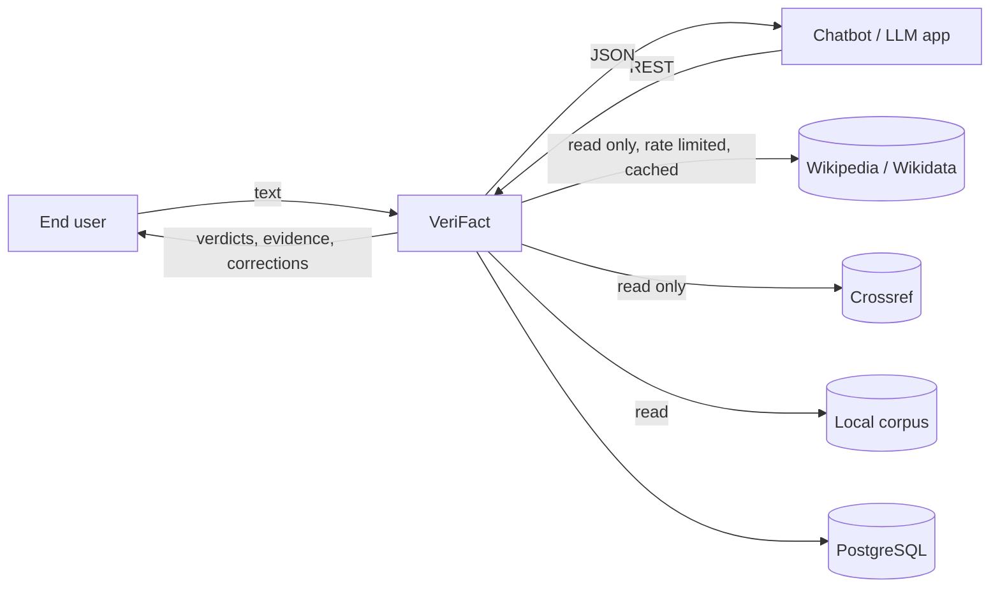
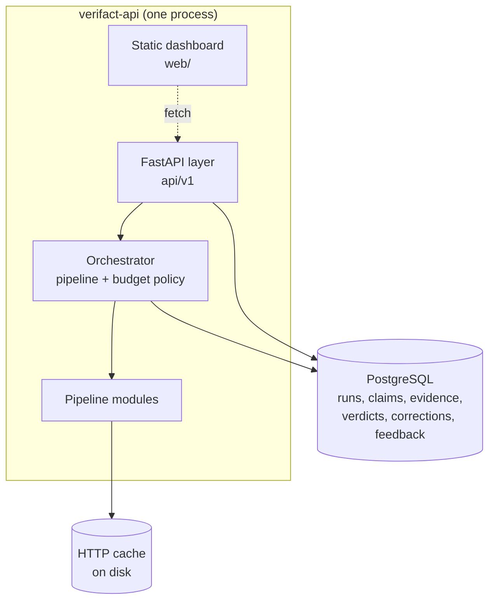
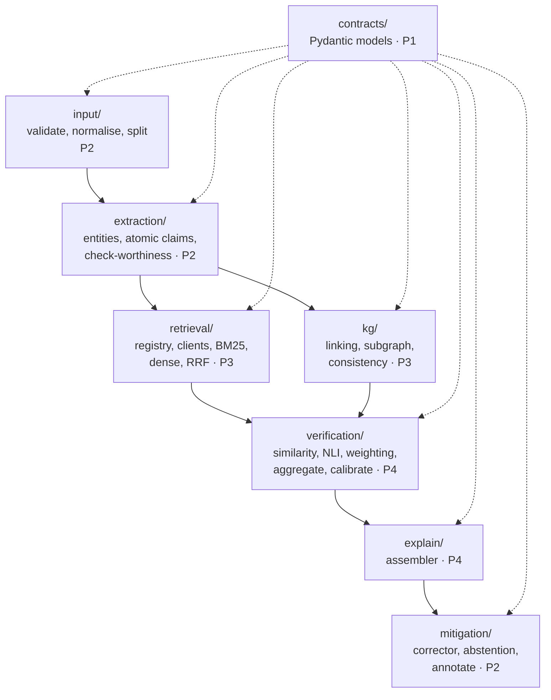
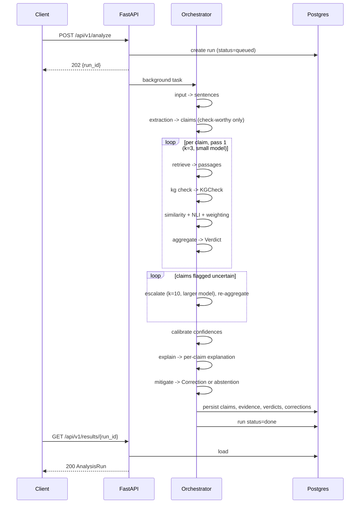
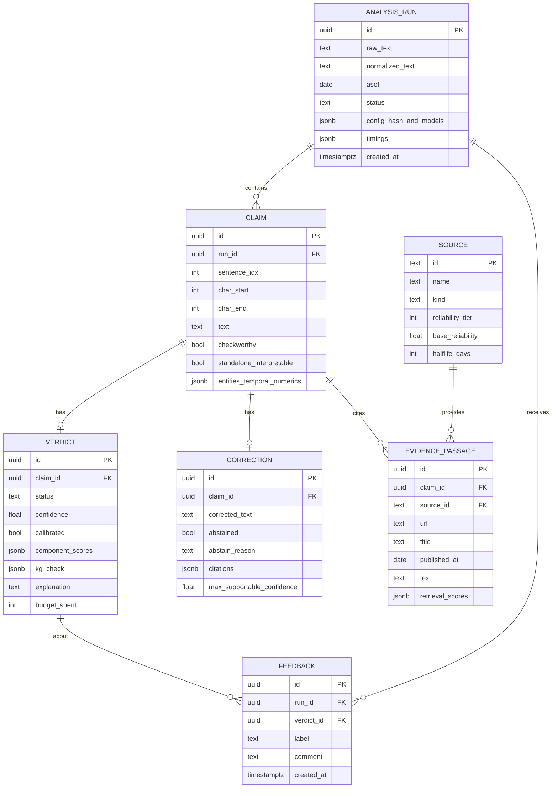
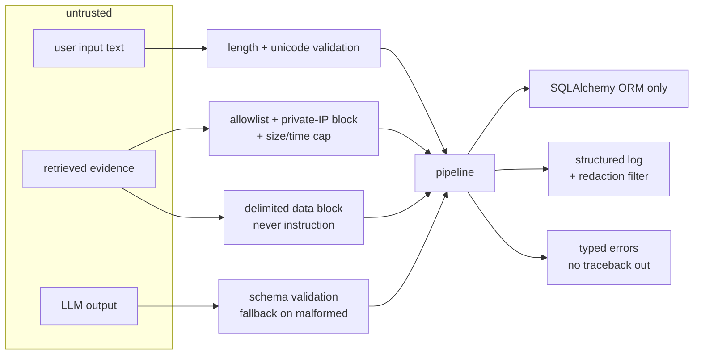

# System Architecture — VeriFact

Version 1.0 (Phase 3) · supersedes `docs/phase-0/02-preliminary-architecture.md` ·
owner P1, reviewed by P2, P3, P4

Diagrams are Mermaid so they live in version control and **cannot drift from the text
unnoticed** — a diagram in a binary image file is the usual way architecture docs become
fiction. Every module named below exists in `src/verifact/`.

---

## 1. Context (C4 level 1)



VeriFact never writes to an external source and never follows a link an external source
supplies. Sources are read-only, allowlisted and cached.

## 2. Containers (C4 level 2)



One process, one database. No queue broker, no second runtime, no container orchestrator.
Rationale: ADR-004 (background tasks over Celery) and ADR-007 (static dashboard over a
Node build). The cost of each omitted component is a thing the team would have to operate
and defend for no measurable gain at this scale.

## 3. Components (C4 level 3)



The dotted edges carry the architectural rule: **modules depend on `contracts/`, never on
each other's internals.** `extraction` does not import `retrieval`; the orchestrator passes
contract objects between them. This is what makes four people able to work in parallel, and
it is what makes each module unit-testable from a fixture.

## 4. Analysis sequence



Partial results are persisted per claim as they complete, so `GET /results/{id}` on a running
job returns what is finished rather than nothing — and a crash mid-run loses one claim, not
the run.

## 5. Failure isolation

| Failure | Behaviour | Why this way |
|---|---|---|
| Retrieval returns nothing | claim → `UNVERIFIABLE`, pipeline continues | FR-30; absence of evidence is not falsehood |
| External source times out | logged, passage set reduced, verdict computed from what arrived, `evidence_coverage` reflects the loss | a slow source must not fail a run |
| Entity linking ambiguous | `KGCheck = NOT_APPLICABLE`, candidates recorded | FR-21; a silent guess is worse than no answer |
| NLI backend unavailable | falls back to the `lexical` backend, `model_versions` records it, confidence marked uncalibrated | the demo must not die; the degradation is visible, not hidden |
| One claim raises | that claim gets an `error` field, the other claims complete | one bad claim must not void the run |
| Postgres unavailable | `/health` degraded, analyze returns 503 | no silent in-memory results |

## 6. The verification stages

| Stage | Produces | Owner | Key reference |
|---|---|---|---|
| S1 similarity | cosine per passage, max and mean | P4 | `reimers2019sbert` |
| S2 NLI | 3-way probabilities per passage (premise = passage, hypothesis = claim) | P4 | `he2021deberta` |
| S3 KG consistency | `KGCheck` with 4 outcomes | P3 | `shiralkar2017streams` |
| S4 reliability × recency | per-passage weight | P4 | — (the gap we target) |
| S5 aggregation + status | `Verdict` with all component scores | P4 | ADR-005 |

### 6.1 The aggregation formula

For claim *c* with retrieved passages *i = 1..k*:

```
w_i = r(source_i) · ρ(age_i) · rel_i                  (per-passage weight)

  r(source)  reliability of the source's tier, in (0, 1]
  ρ(age)     recency decay = 0.5 ^ (age_days / halflife_days(source_kind))
             ρ = 1.0 when no publication date is available, and the
             missing date is recorded (never silently treated as recent)
  rel_i      fused retrieval relevance (RRF score, min-max scaled per claim)

E = Σ w_i · p_entail,i  /  Σ w_i                      (weighted entailment)
C = Σ w_i · p_contra,i  /  Σ w_i                      (weighted contradiction)
coverage = Σ w_i / k                                  (evidence coverage)
```

Near-duplicate passages are collapsed before the sums, so two mirrors of one source do not
count as two independent confirmations — the lesson taken from `kuhn2023semantic` (FR-34).

### 6.2 The status decision rule

Implemented in `verification/aggregate.py`; this and the code must not diverge.

```
if coverage < tau_cov                      -> UNVERIFIABLE   (nothing retrieved)
elif similarity_max < tau_sim              -> UNVERIFIABLE   (nothing on topic)
elif KGCheck == CONTRADICTED               -> CONTRADICTED
elif KGCheck == SUPPORTED:
    if C - E > tau_con                     -> AMBIGUOUS      (KG and text disagree)
    elif max(E, C) < tau_weak              -> SUPPORTED      (KG confirms, text silent)
elif max(E, C) < tau_weak                  -> INSUFFICIENT_EVIDENCE
elif E >= tau_weak and C >= tau_weak       -> AMBIGUOUS      (sources disagree)
elif E - C > tau_sup:
    OUTDATED if outdated(c) else SUPPORTED
elif C - E > tau_con                       -> CONTRADICTED
elif not standalone_interpretable(c)       -> AMBIGUOUS      (unresolved reference)
else                                       -> INSUFFICIENT_EVIDENCE
```

Three branches were added after the first end-to-end run exposed real failures,
and each is a documented finding rather than a tweak:

* **`similarity_max < tau_sim` -> UNVERIFIABLE** (EA-07). `relevance` is min-max
  scaled per claim, so the best candidate always scores 1.0 and coverage could
  never signal "nothing relevant was found". Absolute similarity can.
* **`KGCheck == SUPPORTED` honoured** (EA-05 fallout). The original rule
  consulted the graph only for contradiction. A tier-1 structured confirmation
  was therefore overridable by text NLI, which produced `CONTRADICTED` for
  "Marie Curie won the Nobel Prize in Physics in 1903" - a false positive on a
  true claim, with the graph confirming it.
* **KG and text disagreeing -> AMBIGUOUS, not CONTRADICTED.** Asserting
  contradiction while our most reliable source confirms the claim is the failure
  mode this project exists to avoid.

`MISSING` appears nowhere in this rule, by design (FR-24): the graph not holding
a fact is silence, not denial.

Thresholds live in configuration. **The committed values are placeholders.** They
are fitted on the dev split and frozen with a recorded commit hash before test is
touched (ADR-005), and EA-08 is an open finding that must not be closed by moving
one of them.

`outdated(c)` is true when every supporting passage predates a contradicting passage of
at-least-equal reliability tier, and both carry publication dates. **A `MISSING` KG result
never appears in this rule** — it cannot contribute to `CONTRADICTED` (FR-24).

Thresholds live in configuration, are fitted on dev, and are frozen with a recorded commit
hash before test is touched (ADR-005).

### 6.3 Confidence

`confidence` is `|E − C|` mapped through a calibrator fitted on a held-out dev split
(temperature scaling by default, isotonic as an option). `Verdict.calibrated` is `True` only
when a fitted calibrator was actually loaded. **An uncalibrated score is never presented as a
probability** — in the API, in the dashboard, or in the report (`guo2017calibration`).

## 7. Data model



Relational where the shape is fixed (runs, claims, passages), `jsonb` where the shape is a
nested score bag that we will extend during the project. The alternative — a column per
component score — would mean a migration every time a signal is added, and the scores are
only ever read as a whole.

## 8. Security architecture



The three trust boundaries are input, retrieved content, and LLM output. All three are
validated at the boundary rather than deeper in, so no module further down has to remember to.

## 9. What is deliberately absent

| Not used | Why |
|---|---|
| Kubernetes, Celery, Redis, Kafka | one process and one database are sufficient; each would be operational surface to defend with no measurable gain (ADR-004) |
| Neo4j or a triplestore | per-claim subgraphs are hundreds of nodes; NetworkX in-process is faster and has no deployment cost (ADR-003) |
| React / Next.js / a Node build | four views; a static page removes an entire toolchain and works offline (ADR-007) |
| LangChain or an agent framework | the pipeline is a fixed sequence of five stages; a framework would hide the thing the project exists to explain |
| A vector database service | FAISS flat over a corpus of this size is exact and needs no tuning |
| An LLM in the decision path | unauditable, uncalibrated, non-reproducible (ADR-001) |
